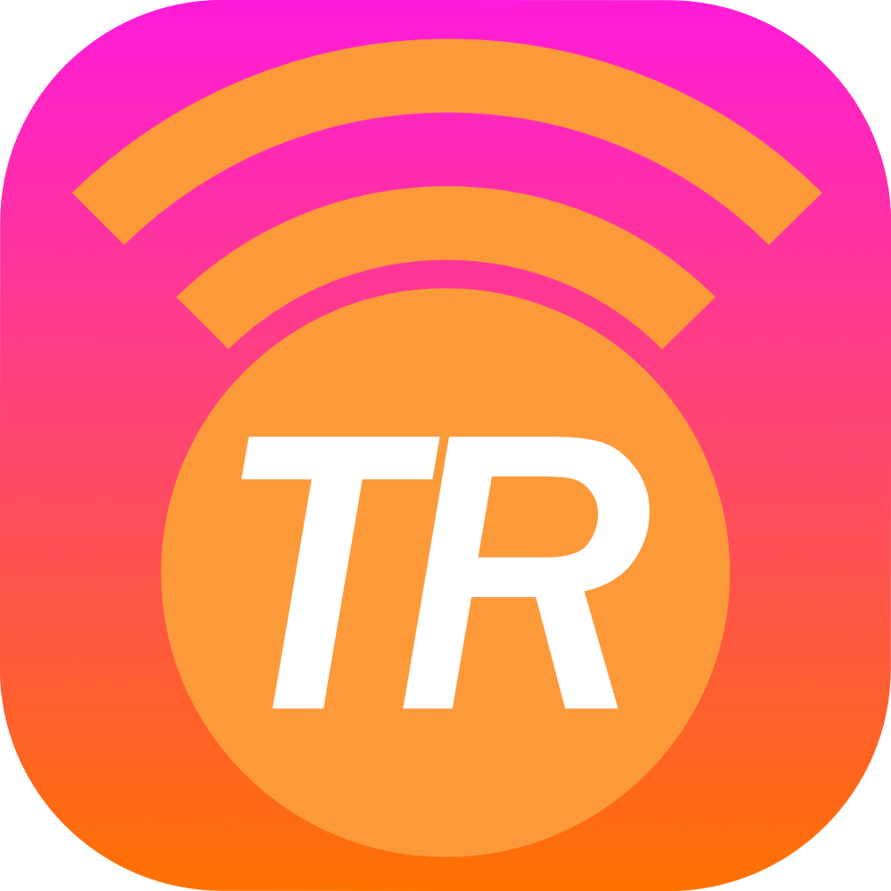

# tiprelay-releases
Installers and updates for TipRelay

TipRelay turns stream events (tips, subs, follows, chat) into actions: VRChat or
Warudo avatar changes, OBS scene changes, on-stream alerts and goals, and Discord
messages. It runs on your own PC, and your sign-ins stay on your PC, encrypted.
You will need to use streamer.bot in order to use some functions.

**[Download the latest version](https://github.com/xanderdigitalVT/tiprelay-releases/releases/latest)**

## What it does

**Events come in from:**

- **Twitch:** follows, subs, resubs, gift subs, bits, raids, channel-point redemptions and chat
- **Kick:** chat, follows, subs, gifted subs, KICKs and reward redemptions, through your own free relay on Cloudflare
- **Fansly:** tips, subs and chat, read from Fansly's own page in a window. This connection is unofficial and only reads, so TipRelay sends nothing to your chat.
- **Joystick.TV:** tips with tip-menu items, follows, subs, resubs, gift subs and chat
- **StreamElements and Streamlabs:** tips and donations, with amount and currency
- **Streamer.bot:** YouTube, Ko-fi, TipeeeStream, Fourthwall and Throne, plus Fansly as a backup. An event that comes through both only counts once.

**Actions go out to:**

- **Your avatar:** VRChat through OSC, or Warudo through its WebSocket. You choose one on the Connections page.
- **OBS:** switch scenes, show or hide sources and set text
- **Overlays:** alerts, goals, wheels, a tip menu and counters as OBS Browser sources, with one combined overlay for NSFW sites and one for SFW sites
- **Chat and Discord:** chat messages and Discord webhook posts. Mentions are disabled, so viewer text can't ping `@everyone`.

**Features:**

- **Rules:** a trigger, then a list of actions, with cooldowns and a queue so alerts don't overlap. Chat rules can be limited to mods and a list of names.
- **Goals:** chained goals that count one running total, so the next goal continues from where the last one finished
- **Wheels and counters:** driven by tips and chat commands
- **Tip menus:** keep a menu for each currency or site and swap which one is in use. A menu can count in money, Joystick.TV tokens, Twitch bits, Kick KICKs or subs, and it only matches tips in its own unit.
- **Activity feed:** follows, subs, tips and similar events with a tab for each site, without chat. It keeps your latest 500 events across restarts.
- **Stream titles:** change your title on Twitch and Kick at once, and keep a list of saved titles
- **Hide NSFW sites:** one button in the App section of the Connections page hides Fansly and Joystick.TV across the app, for when your screen is on stream. What shows in OBS doesn't change.
- **Test events:** fire any event by hand, without going live
- **Backups:** export and restore your settings and rules
- **Automatic updates:** new versions download in the background, and TipRelay never restarts by itself. The version number and a **Check for updates** button are at the bottom of the sidebar.

Your settings are kept in `%APPDATA%\TipRelay\config.json`. Sign-ins and tokens are encrypted with Windows DPAPI in `secrets.bin` in the same folder. The Fansly management session is kept on your PC too, but it may not be encrypted, and it never includes your password.

## Install

1. Download `TipRelay-<version>.zip` from the [latest release](https://github.com/xanderdigitalVT/tiprelay-releases/releases/latest) and extract it.
2. Run `TipRelay-Setup-<version>.exe`. If Windows says "Windows protected your PC," click **More info**, then **Run anyway**. This appears because the app isn't code-signed.
3. Follow the installer. TipRelay then appears in your Start menu.

## Connecting your accounts

Set up only what you use. Each card on the Connections page has its own instructions.

- **Twitch:** create an app at https://dev.twitch.tv/console/apps with client type **Public** and redirect URL `http://localhost`, then paste its Client ID and click **Connect Twitch**. If your app is Confidential, paste its client secret too, or Twitch signs you out every few hours.
- **Kick:** set up your own relay by following `relay\SETUP.txt` in the zip, which takes about 20 minutes and is free. To use Stream titles, turn on channel write access in your Kick app.
- **Fansly:** on Fansly, open **Management Sessions**, click **Create Session**, name it TipRelay, leave its permissions off and copy its link. Paste the link and your chat URL on the Fansly card and click **Open Fansly**. The link works once, and TipRelay keeps the session until you click **Sign out**. Keep the Fansly window open while you stream; you can minimize it.
- **Joystick.TV:** create a bot application on joystick.tv with redirect URL `http://127.0.0.1/callback`, then paste its Client ID and click **Connect Joystick.TV**. A public app stays signed in for 4 hours at a time, and a confidential app with its client secret lasts 10 days.
- **StreamElements or Streamlabs:** paste your StreamElements JWT token or Streamlabs Socket API token on its card and click **Connect**.
- **YouTube, Ko-fi, TipeeeStream, Fourthwall and Throne, or Fansly as a backup:** connect the site in Streamer.bot first, Fansly through its extension. Then follow the steps on the Streamer.bot card, which give you a script to copy in.
- **OBS:** in OBS, go to **Tools → WebSocket Server Settings** and turn it on, then copy the port and password to the OBS card.
- **VRChat:** open the Action Menu, go to **Options → OSC** and turn on **Enabled**.
- **Warudo:** choose Warudo under **Avatar app**, then add an **On WebSocket Action** node to a blueprint for each action name your rules send.
- **Discord:** in a channel's settings, go to **Integrations → Webhooks → New Webhook** and copy the webhook URL. Save it on the Connections page under a name you'll recognize.

Then add a rule on the **Rules** page, try it from **Test & activity**, and add your overlay address to OBS as a Browser source.
